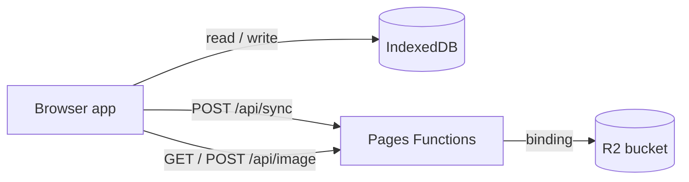

# Med Notes

A local-first, installable study-notes web app for medical students. Notes, images and saved AI conversations are organised in a notebook-style binder, work offline, and sync across devices through Cloudflare R2.

Built with vanilla JavaScript and Cloudflare Pages Functions. No framework, no database, no build step.

## Features

- Courses, topics and notes nested to any depth
- Markdown notes with highlights, callouts, task lists, tables, `[[wiki links]]` and chat-style conversation blocks
- Image paste and upload, compressed in the browser before sync
- Offline-first: everything is saved on the device and syncs when a connection returns
- Installable as a PWA on phone and desktop
- Full-text search across all notes
- Single-user password login and automatic daily backups

## Tech stack

| Layer | Choice |
|---|---|
| Frontend | Vanilla JavaScript, HTML, CSS (no framework, no bundler) |
| Local storage | IndexedDB |
| Offline | Service worker, web app manifest |
| Backend | Cloudflare Pages Functions (Workers runtime) |
| Cloud storage | Cloudflare R2, connected through a binding |
| Auth | HMAC-signed HttpOnly cookie via the Web Crypto API |
| Tests | Node's built-in test runner |
| Hosting | Cloudflare Pages |

## Architecture



The browser is the primary copy of the data. The server is a thin layer that checks the login cookie, validates incoming data, merges it into the stored notebook and returns the result.

R2 holds three kinds of object:

| Key | Contents |
|---|---|
| `notebook/doc.json` | All notes and folders as one JSON document |
| `notebook/images/<id>` | One object per image |
| `notebook/backups/doc-<date>.json` | A copy of the previous day's document |

## How it was built

### 1. Local-first data model

The notebook is a flat map of nodes keyed by id. Each node is a folder or a note and carries `parentId`, `order` and `updatedAt`. A flat map keeps merging simple, and moving a note is a one-field change. Every edit is written to IndexedDB first, so the app is fully usable offline.

### 2. Sync by merging, not overwriting

Two devices can edit the same notebook while offline, so the sync endpoint merges instead of replacing:

- For each node id, the copy with the newer `updatedAt` wins.
- A deletion is stored as a tombstone (`deleted: true` plus a timestamp), so an old copy on another device cannot bring a deleted note back.
- On a timestamp tie, a delete wins.
- A single `POST /api/sync` sends local changes and returns the merged notebook. The server only writes to R2 when the merge actually changed something.

The same rule runs in the browser (`public/merge.js`) and on the server (`functions/_lib/merge.js`). A test checks that both copies give identical results on 500 random inputs, so they cannot drift apart.

### 3. A small, safe backend

- **Auth.** One password, compared in constant time. A successful login sets a signed, `HttpOnly`, `SameSite=Lax` cookie, and `Secure` on HTTPS. Cookies are signed with HMAC-SHA256 through the Web Crypto API. Without the password secret set, the API stays closed and the app runs in a local-only demo mode.
- **Validation.** Every incoming node is cleaned on the server: ids and types are checked, strings are length-capped, unknown fields are dropped and the node count is limited.
- **Images.** The browser shrinks pictures to WebP before upload. The server identifies the file type from its first bytes instead of trusting the client, stores that type with the object, and serves images with `nosniff` and a sandboxed Content-Security-Policy.

### 4. Moving from Vercel to Cloudflare

The first version ran on Vercel and reached R2 over its S3-compatible API with a hand-written SigV4 request signer. Moving to Cloudflare Pages let that code go:

| Before | After |
|---|---|
| Account ID, access key and secret as environment variables | One R2 binding in `wrangler.toml` |
| Hand-written SigV4 signer | `env.BUCKET.get()` and `env.BUCKET.put()` |
| Node `crypto` | Web Crypto API |
| Node request and response objects | Standard `Request` and `Response` |

### 5. Custom Markdown renderer

`public/md.js` is a small renderer written for this app instead of a library. It escapes HTML, blocks `javascript:` links and adds the app's own syntax: callouts, `==highlight==`, `[[wiki links]]` and `chat` blocks, which render a conversation as speech bubbles.

### 6. Offline and installable

A service worker caches the app shell and serves it immediately, refreshing it in the background. Images are cached after first view. API calls are never cached.

### 7. Testing

Backend tests run against an in-memory fake of the R2 binding, so they need no Cloudflare account. They cover:

- the full login, sync, image and logout flow
- merge rules and the server and browser merge parity check
- input validation and image type sniffing
- cookie signing, tampering and expiry
- the closed-API behaviour when settings are missing

## Project structure

```
public/            App served as static files (index.html, app.js, md.js, merge.js, sw.js, styles, icons)
functions/api/     Pages Functions: status, login, logout, sync, image
functions/_lib/    Shared server code: config, auth, validation, merge, HTTP helpers
test/              Backend and Markdown tests
scripts/           Icon generation and a single-file demo build
wrangler.toml      Cloudflare Pages settings and the R2 binding
```

## Getting started

Requires Node.js 20.19 or newer and a Cloudflare account.

```bash
git clone https://github.com/<your-username>/med-notes.git
cd med-notes
cp .dev.vars.example .dev.vars   # set NOTEBOOK_PASSWORD
npm run dev                      # http://localhost:8788
npm test
```

`npm run dev` runs a local simulated R2 bucket, so development never touches real data.

### Deploy

1. Set `bucket_name` in `wrangler.toml` to your R2 bucket.
2. Create the Pages project and deploy:

```bash
npx wrangler login
npx wrangler pages project create <project-name> --production-branch main
npx wrangler pages deploy
```

3. Set the password secret and deploy again:

```bash
npx wrangler pages secret put NOTEBOOK_PASSWORD --project-name <project-name>
npx wrangler pages deploy
```

## Limitations

- Single user, one shared password. It is not a multi-user system.
- The whole notebook is one JSON document, which suits personal notes but would need splitting for very large notebooks.
- Concurrent edits to the same note resolve by newest timestamp, not by character-level merging.

## Development notes

Developed with AI pair-programming assistance (Claude).

## License

[MIT](LICENSE)
